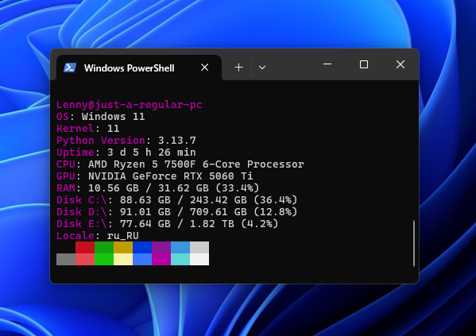

# yafetch


yet another fetch app, written in Python

## Installation
requires Python 3.11+ (tested on 3.13)
```
git clone https://github.com/Lennichijou/yafetch.git
cd yafetch
python -m yafetch
```

## Configuration
config is optional TOML. location:

| OS | path |
|---|---|
| Windows | `%APPDATA%\yafetch\config.toml` |
| Linux/MSYS2 | `~/.config/yafetch/config.toml` (or `$XDG_CONFIG_HOME`) |

Override with `YAFETCH_CONFIG=path/to/config.toml` or `--config`.
`NO_COLOR` env var and `--no-color` disable ANSI colors.

example `config.toml`:
```toml
accent = "bright_cyan"      # black..white, bright_black..bright_white
bold = true
separator = ": "
show_swatch = true
modules = ["os", "kernel", "shell", "python", "uptime", "mainboard", "cpu", "gpu", "ram", "disks", "locale", "battery"]  # subset
hide_disks = ["D:", "E:"]   # drive letters on Windows, mount points on Linux
```

inspired by other tools featured on awesome-fetch list
